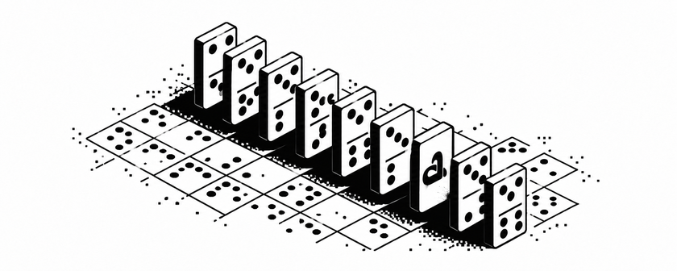

# gamesworkshop



Games about evidence, decisions and consequences.

## Summit

```sh
./run-summit.sh
```

Requires Linux and Python 3. The launcher restarts the Summit server. Ctrl+C to kill.

[Game guide](GAME_INDEX.md) - [Setup and rebuilding](docs/REBUILD.md)
