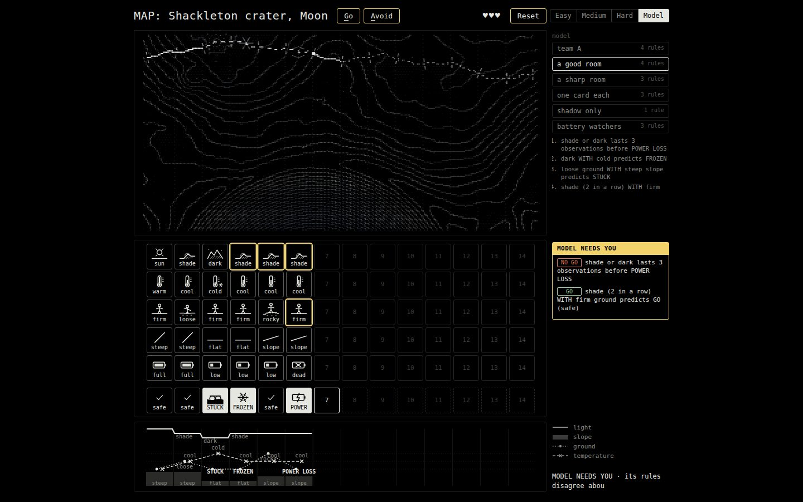
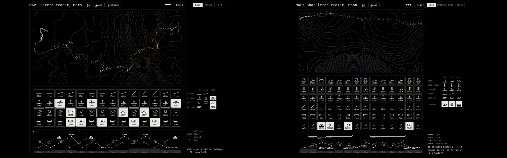

# Moon Run

Rover Run's method, used on a new world. On Mars the room learns to work backwards from a failure
to its early warning. On the Moon, nobody tells them the warnings: the audience holds fragments
of a larger archive, proposes rules in a three-word language, **verifies** them against everything,
and hands the ones that survive to a representative. The representative builds a small model, the
model drives the whole archive and stops to ask a person when its rules disagree, and then it meets
a sealed 14-square route that nobody has seen. Sudden death settles it.

Built from [`proposals/ROVER_COMPETES.md`](../../proposals/ROVER_COMPETES.md), with the event plan in
[`narrative/EVENT.md`](../../narrative/EVENT.md) and [`COMPETITIVE.md`](../../narrative/COMPETITIVE.md).
It is a fork of Rover Run (`space/rover-run/src/`), which is untouched.





## Run it

```
cd moon/claude
python3 serve.py                 # http://<host>:8676/web/stage.html   (Rover Run stays on 8670)
node tools/sim.mjs               # strategies and the 43 design checks
```

| Page | Who | What |
| --- | --- | --- |
| `stage.html` | facilitator | the event flow, every team's rules/model/runs, sealed-route replays |
| `archive.html` | everyone (projected) | all 20 histories; click a card for "x of n"; **L** shows the hidden laws |
| `print.html` | facilitator | the printable fragments, and the coverage check per team |
| `rules.html?p=A07` | each participant (phone) | their fragment, the rule builder, the evaluator, publish |
| `model.html?team=A` | each representative | clustered rules with supporters, cap of 4, clashes, lock, the archive run |
| `index.html` | stage | the sealed 14-square board: Easy / Medium / Hard for people, **Model** for team models |
| `sudden.html` | stage | the finale: one square ahead, GO or NO GO, wrong either way and you are out |

## The event

1. **Mars, Hard** (Rover Run, 8670): four representatives, two cards per square.
2. **Mars, Easy**: the whole board. A: what ends the run? B: what came before it? C: what explains
   when the warning mattered? D: what arrives too late?
3. **Moon archive.** Hand out fragments (`print.html`); project `archive.html`. Each person holds
   one short history and two of its five measurement rows, plus what happened. They write one rule:

   | | The question | The blanks |
   | --- | --- | --- |
   | **BEFORE** | What tends to appear before failure? | ___ happens before ___ |
   | **PERSISTS** | What becomes dangerous when it lasts? | ___ lasts ___ observations before ___ |
   | **WITH** | What only matters when another condition is present? | ___ ( _ in a row) WITH ___ predicts ___ |

   **Evaluate** tests it on all 117 observations, not just theirs. Graduated rules (70+) can be
   published to their representative.
4. **The model.** The representative sees their section's rules clustered, with supporters, scores
   and denominators; chooses at most 4; sees where two chosen rules can disagree; locks.
5. **Archive run.** The model drives every history, card by card. Routine steps are automatic; where
   a NO GO rule and a GO rule both fire, it stops: **MODEL NEEDS YOU**. It ends with failures
   stopped, false alarms, steps decided by the model and by the person, and the same model on 20
   **held-out** histories nobody has seen.
6. **Sealed route** (`index.html`, Model mode, `?team=A`): 14 squares, the same information for every
   team (every card of every square behind the rover, nothing ahead). +1 a square driven, +3 to
   finish, −2 a failure, 3 lives. Each run is stored for the replay strip on `stage.html`.
7. **Sudden death** (`sudden.html`): eight curated cases. Each shows the recent observations; the
   square ahead is hidden. GO on a failure, or NO GO on a safe square, and the team is out. Each
   case is one that a plausible rule gets wrong (checked in `tools/sim.mjs`). The reveal also shows
   what each team's model would have said: the best historical model does not win every case.
8. **Replay and discussion**: which rule made the difference; where a person had to decide.

## What the cards measure

Five rows, each low / mid / high, and a sixth row apart from them for what happened. The outcome
row is never a clue for itself.

| Row | Values | Real or authored |
| --- | --- | --- |
| light | sun / shade / dark | **real** on the sealed route (LOLA average solar visibility, bucketed: sun ≥ 50 % of the time, dark < 14 %); authored in the archive |
| temperature | warm / cool / cold | authored |
| ground | firm / loose / rocky | authored (Rover's firm and soft figures; a new rocky one) |
| slope | flat / slope / steep | **real** on the sealed route (LOLA 80 m DEM, median along each strip: flat < 4°, steep ≥ 10°); authored in the archive |
| battery | full / low / dead | a recorded reading that follows the laws: low after two non-sun observations, dead at a power loss |
| happened | safe / POWER LOSS / FROZEN / STUCK | follows from the hidden laws |

**Honesty.** The terrain, the route's light and its slope are real; the relationships are authored
teaching data. Discovering them demonstrates the method; it says nothing about the real
probability of a lunar rover freezing. The archive's JSON and the archive page say so.

## The hidden laws

Each law reads the observation you were just at and decides what happens at the next one, so the
only evidence about the square ahead is behind you (Rover Run's REUSE lesson: never show the
hazard ahead).

- **POWER LOSS** (PERSISTS): shade or dark three observations running, **unless** the ground at the
  third is firm (on firm ground the rover drives out to sunlight in time).
- **FROZEN** (WITH): dark **with** cold. Either alone is survivable.
- **STUCK** (WITH): loose ground **with** a steep slope. Either alone is survivable.
- **Battery** (a late measurement): low after two non-sun observations, dead at the power loss.
  "Dead battery before power loss" is a strong relationship and arrives too late.

Two archive cases are lucky escapes (the law fired, the rover got through), so rules are 4 of 5,
not certain.

## The archive

`tools/build_archive.mjs` builds everything from the laws with fixed seeds (`web/data/`):

- **archive.json**: 20 histories, 117 observations. Failures: power 4, frozen 4, stuck 4; 8 safe
  histories, among them the look-alikes that make false alarms meaningful: three shaded on firm
  ground (escape), cold in the sun, dark but mild, loose but not steep, a two-step shade that
  recovers.
- **holdout.json**: 20 more histories from the same laws (a different seed): the hidden comparison.
- **route.json**: the sealed route. Light and slope measured; ground and temperature authored square
  by square (the reasons are in the script) so the same laws make new combinations: STUCK at 3,
  FROZEN at 4, POWER LOSS at 6 and 13; two MODEL NEEDS YOU moments (6 and 11, both firm ground
  under a long shadow).
- **sudden.json**: eight cases, each with the reason it is there.

**Fragments** (`web/fragments.js`): participant *i* of team *T* gets history `(7i + 3T) mod 20`. Even
participants hold the pair that matters for their history (light+ground for power, light+temperature
for frozen, ground+slope for stuck); odd participants hold a partial or late slice of it
(light+battery, temperature+ground, slope+battery). `print.html` checks that every team holds at
least 2 copies of each law's evidence, the firm-ground escape, and the late battery slice.

## The evaluator

Plain questions: did it catch bad outcomes? how often did it cry wolf? was there time to act?

- A NO GO rule **catches** a failure if it fired 1–3 observations before it. Firing only at the
  failure is **too late**. A run of firings that no failure follows within 3 is a **false alarm**.
- **VERIFICATION** = 100 × F1(caught share, share of alerts that were right) × support, where
  support = alerts / 4 (capped at 1). Fewer than 4 alerts: **too few cases**.
- A GO rule ("even then, safe") is scored on lift over the base rate (squared), so "sun means safe",
  true 95 % of the time but no better than average, scores 37.
- 70 graduates. The distribution (`tools/rules-probe.mjs`):

| Rule | Score | Verdict |
| --- | ---: | --- |
| shade or dark (3 in a row) WITH loose or rocky ground → POWER LOSS | 100 | graduates |
| dark WITH cold → FROZEN | 89 | graduates |
| loose ground WITH steep slope → STUCK | 89 | graduates |
| shade (2 in a row) WITH firm ground → GO | 100 | graduates |
| shade or dark lasts 3 → POWER LOSS (the general precursor) | 73 | graduates |
| dark → FROZEN | 62 | keep testing |
| cold → FROZEN | 43 | keep testing (16 false alarms in 22) |
| loose ground → STUCK / steep → STUCK | 39 / 33 | keep testing |
| low battery → POWER LOSS | 53 | keep testing |
| dead battery → POWER LOSS | 0 | **too late** |
| shade or dark (3) WITH firm → GO; dark (2) WITH cold → FROZEN | – | **too few cases** |

## The model and MODEL NEEDS YOU

`decide()` in `web/moon.js`: NO GO rules that fire say NO GO, GO rules say GO, nothing firing means
GO. **Both at once: the model stops and asks.** `model.html` warns before locking ("these two
disagree 2 times in the archive").

The designed conflict is the proposal's own example: *a long shadow says NO GO; a long shadow on
firm ground says GO.* With the general shadow rule plus the firm exception, the model asks twice
in the archive and twice on the sealed route. A sharper power rule (one that already knows about
firm ground) never needs to ask: the better the rule, the less the person is needed.

## Simulation (`node tools/sim.mjs`)

Sealed route: best possible 13 (10 safe squares + 3). Asks answered correctly ("oracle") or with
NO GO ("cautious").

| Strategy | Archive | Unseen | Sealed | (cautious) | Deaths |
| --- | ---: | ---: | ---: | ---: | ---: |
| always GO | 0 | 0 | −3 | −3 | 3 |
| always NO GO | 22 | 22 | 4 | 4 | 0 |
| random (50 runs) | 20 | 20 | 3.3 | 3.6 | 1.9 |
| one card: dark / loose / steep / cold | 55 / 29 / 34 / 24 | | 3 / 8 / 2 / 8 | | |
| BEFORE only | 33 | 38 | 7 | 7 | 0 |
| PERSISTS only (shadow 3) | 44 | 44 | 6 | 6 | 2 |
| WITH only (frozen, stuck) | 73 | 73 | 9 | 9 | 2 |
| partial: no frozen rule | 76 | 76 | 10 | 8 | 1 |
| battery watchers (late) | 33 | 39 | 7 | 7 | 1 |
| **a good room (intended)** | **92** | **92** | **12** | **10** | 0 |
| a sharp room | 92 | 92 | 13 | 13 | 0 |
| every graduated rule (simulated rooms) | 92 | 92 | 12 | 10 | 0 |

The 43 checks: balance; archive size; every outcome follows the laws; intended rules graduate;
single cards keep testing; the lagging rule is too late; overfit rules have too few cases; context
improves the shadow rule; ~2 asks in the archive and on the sealed route; the intended model beats
every naive and partial model on the sealed route; no single card dominates; every sudden-death
case is wrong for some plausible model.

`web/audience.js` is a simulated room (each fragment-holder tries the obvious rules from their two
rows, revises once, publishes what graduates); `model.html`'s **Rehearse** button uses it.

## The look

Rover Run's: the same dot-matrix map with strips aligned to card columns, the same bordered cards
and line glyphs (firm/loose figures, slope lines and battery reused; light, thermometer, rocky and
the three outcomes are new), the same three stacked panels, typed instruction line, lives, Reset
and modes. Changes: contour tint (cold blue-grey hollows to pale rims), a sixth card row set apart
for what happened, a Model mode, and one new death screen (**frost**: ice crystals grow in from the
edges). POWER LOSS is Rover's TV switching off; STUCK is the sand-trap spiral in grey dust.

The map is a 27.7 km authored traverse on the outer flank of Shackleton crater
(88.97°S 140.6°E to 89.22°S 195.9°E), framed so the crater's wall shows as an arc at the bottom;
contours every 120 m from the LOLA 80 m DEM.

## Data (Seagate, read only)

`/mnt/seagate/gamesworkshop/moon/claude/raw/`, each with a `.sha256`:

- `LDEM_80S_80MPP_ADJ.TIF`: LOLA south-pole DEM, 80 m (NASA GSFC PGDA product 90)
- `AVGVISIB_85S_060M_201608.TIF`: average solar visibility, 60 m (Mazarico et al., PGDA product 69)

`.venv/bin/python tools/prep_moon.py` → `web/map.json` and `web/data/route_real.json`; then
`node tools/build_archive.mjs` → everything else. (`.venv` and `node_modules` are symlinks to Rover
Run's.)

## Playtesting

`tools/agent-play.mjs` drives the real pages for an outside player (`MOON_ME=A04`, default B04;
first a participant, then that team's representative): `fragment`, `archive`, `rule ...`,
`publish`, `candidates`, `model ...`, `decide`, `sealed`. The prompt is `tools/agent-prompt.md`.
Screens are in `assets/`; full notes in the chronology
([`chronology/2026-10-06-moon-claude.md`](../../chronology/2026-10-06-moon-claude.md)).

- **Two blind agents** (no code, no data) both did the method as a participant. One went from
  "cold → FROZEN" (43) through five combinations to "cold WITH dark" (89). The other dropped the
  tempting shadow story for "low battery lasts 2 → POWER LOSS" (73) within the 6-test budget.
- **Me, by hand on Hard**, 12 of 13. Mars instincts saved the first two failures. Hard's two
  picks per square showed that firm ground after a long shadow was safe, by square 11.
- **Open issue: the representative's step can be done by score.** Both agents picked the four
  highest-scoring rules. Because the simulated room (and so the rehearsal menu) contains the sharp
  power rule, which already knows about firm ground, their models never asked them anything, and
  both scored 13 of 13. This is the proposal's "a focused model handles more automatically", and
  `model.html` now says so when a model has no clashes. But the human-in-the-loop moment only
  appears for models built around the plain shadow rule, which is the one real audiences are most
  likely to find. Options before an event: leave it as the talking point ("why did team B's model
  never need a person?"); keep the sharp rule out of the rehearsal room; or design one sealed square
  the archive never showed (a novel combination) where every model must ask.

## Design decisions that failed (kept, not deleted)

- **Temperature with four levels** (hot / warm / cool / cold, as proposed). No law used hot, and four
  levels broke the low / mid / high key every other row shares. Three levels.
- **Safe rules scored on precision.** "Sun means safe" graduated at 93. Now lift over the base rate.
- **The first archive stopped the intended model 8 times** (escape histories with four shaded
  observations, frozen histories with long shaded leads). Trimmed to three-shade escapes and short
  leads: 2 stops.
- **No cost for a failure.** Rover charges a death in turns, but Moon has no recharge and so no
  clock; a model that drove into two failures tied a perfect run. A failure now costs 2 points.
- **60 m contours, route centred.** Generic squiggles, not the Moon. Shifting the frame 5 km toward
  Shackleton (its flank becomes an arc) and 120 m contours made it lunar at a glance.
- **A shadow stipple layer** (`?map=shade`, on by default) is real data but barely visible under the
  contours; `?map=contours` drops it.
- **Light buckets are fragile.** Adding a wander to the straight route moved two squares between
  shade and sun, and the first dark threshold (8 %) left no dark square; the wander was re-tuned
  and the threshold set to 14 %. Rerun `build_archive.mjs` after any change to `prep_moon.py`: it
  refuses a route whose outcomes differ from the design.
- **Simulated rooms all found the same rules** when every fake participant tried rules in the same
  order; now a quarter combine before they look at duration, which gives teams different menus.
